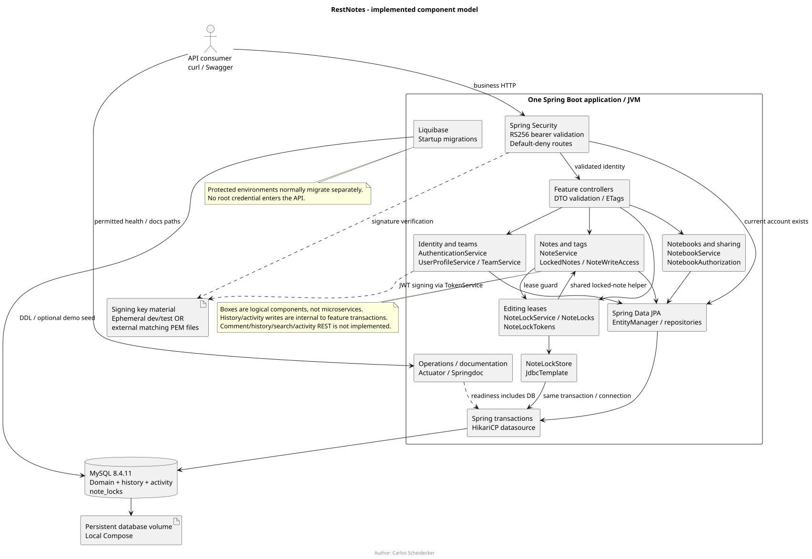
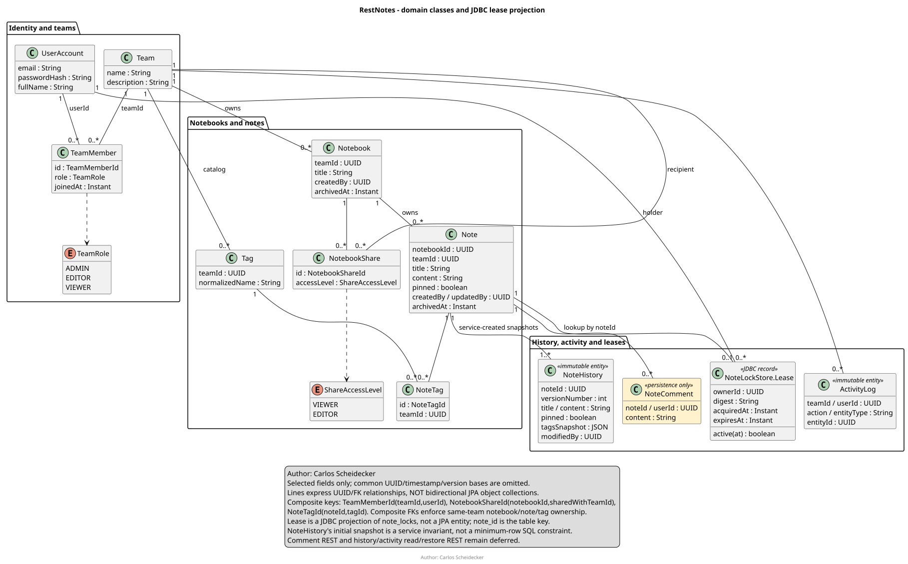
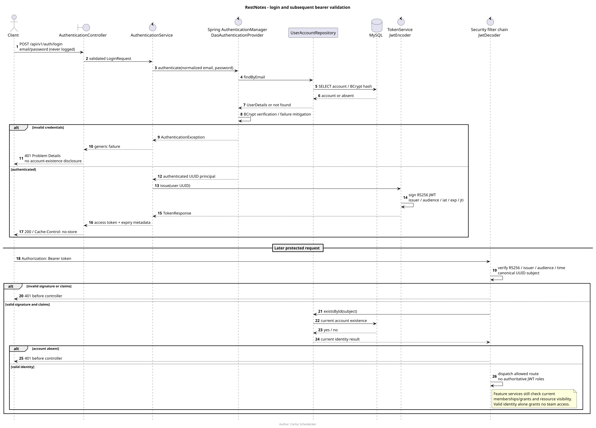
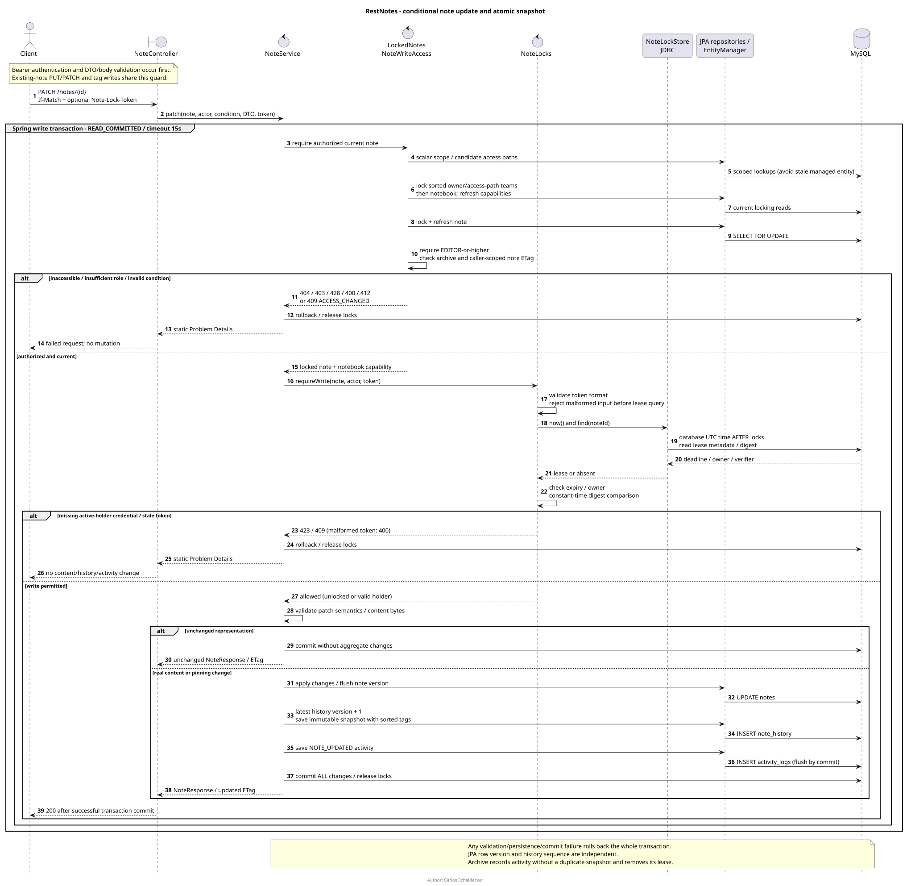
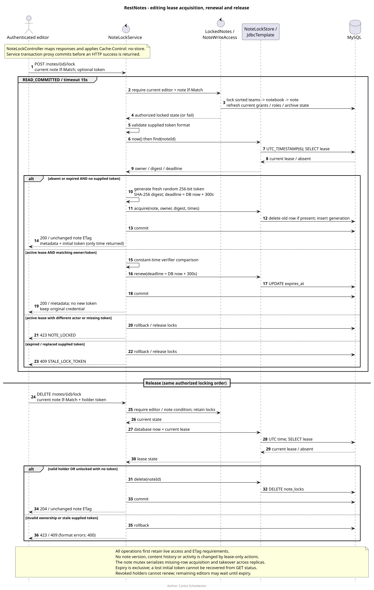

# RestNotes architecture
Author: Carlos Scheidecker

This document describes the implemented API through note locking.  See [features summary](features-summary.md), [system requirements](system-requirements.md) and [API contracts](API.Design.md) for complementary detail.

## 1. Architectural scope and decisions
RestNotes uses one Java 25 Spring Boot application, one Maven module and one MySQL database. Feature packages separate responsibilities within that deployment; they are not separately deployed microservices. This keeps live note changes, history and activity inside a local database transaction and avoids distributed authorization/cache coordination for a small-team service.

The baseline is Spring Boot 4.1.1, Springdoc 3.1.1, Maven Wrapper 3.9.16, MySQL 8.4.11 and Liquibase Community 5.0.4. Boot manages compatible Spring/Security/Hibernate/JDBC/Testcontainers dependencies; the Liquibase override is explicit. No preview Java feature, WebSocket broker, Redis server or external identity provider is required.

The primary goals are tenant isolation, immediately effective permissions, bounded REST representations, lost-update prevention, atomic history and reproducible upgrades. The design deliberately accepts coarse team/notebook serialization for correctness at small-team scale. Contention and throughput must be measured before replacing these boundaries. The [README design rationale](../README.md#most-time-consuming-design-choices) explains the main trade-offs and [future improvements](../README.md#what-would-i-change-add-or-stop-doing-if-i-had-time) describe alternatives.

## 2. Component and runtime view


[PlantUML source](diagrams/component-model.puml) · [Open SVG](diagrams/component-model.svg)

The diagram's application box is a single JVM:
- Controllers translate HTTP, validate request DTOs, derive actor identity from the validated JWT and return scalar/page DTOs with appropriate ETags.
- Services own business authorization and transaction boundaries; repositories are not exposed as HTTP resources.
- Spring Data JPA/EntityManager stores the domain model; JdbcTemplate stores editing leases. Both use the same datasource and participate in the same JPA-managed Spring transaction when called by a write service.
- Liquibase owns schema evolution and optional demo initialization; Hibernate validates mapped entities, not the JDBC-only lease projection.
- Actuator and Springdoc are framework surfaces in the same process. Only approved health/info routes are public; documentation is dev/test-only. Those permitted paths still pass through the configured security chain.

Local Compose runs two containers on one network: the non-root API and MySQL with a persistent named volume. Only the API publishes a loopback host port (8081 by default); MySQL remains internal. Health dependency ordering delays API startup until the application database/user is usable. The image builder runs unit/style checks, while full host verification uses disposable Testcontainers databases rather than mounting a Docker daemon into the builder.

The API has no production ingress/TLS proxy, managed backup service or secret-manager integration provisioned by this repository. Those are deployment responsibilities. Root database credentials belong only to MySQL initialization, never the API. The local development account can run migrations within RestNotes; protected deployments should use separate migration/runtime identities and migrate before application rollout.

## 3. Package responsibilities and dependency boundaries
All Java packages are under `src/main/java/com/scheideckerantunes/notes/`:
- `auth/`: registration/login, email normalization, BCrypt constraints, JWT key/settings/token support.
- `user/`: safe profiles and access-scoped current-user affiliations.
- `team/`: team creation/discovery and serialized membership administration, including last-admin protection.
- `notebook/`: owner-admin metadata/archive, team sharing, visibility predicates, role resolution and notebook validators.
- `note/`: CRUD/pinning/tags, byte/body limits, note validators, locked authorization and lease lifecycle/enforcement.
- `history/`, `activity/`: internal immutable snapshot/activity entities and repositories.
- `comment/`: comment persistence foundation only; no comment controller/service workflow is exposed.
- `common/`: UUID/audited/versioned bases, page envelope, correlation IDs and safe Problem Details.
- `config/`: security, JWT wiring, migration entry-point selection, database safeguards and OpenAPI.

Controllers depend on services, which coordinate repositories and policy helpers. UUID references intentionally avoid an unbounded bidirectional JPA graph. DTOs are distinct from entities, and Open Session in View is disabled. Validation and exception handling must not echo note bodies, submitted credentials, JWTs or lock tokens. Shared helpers are implementation components, not a new authorization API.

## 4. Domain class view and persistence invariants


[PlantUML source](diagrams/class-model.puml) · [Open SVG](diagrams/class-model.svg)

This is a selected domain-class view, not a complete generated API reference or a diagram of JPA object navigation. Lines describe explicit UUID/key relationships. The common base hierarchy is UuidEntity → AuditedEntity → VersionedEntity; teams/notebooks/notes use the versioned base, while other entities use the appropriate UUID/audited base or explicit composite key.

Important invariants:
- User identity is global to this application; a role belongs to TeamMember, not UserAccount.
- Notebook has exactly one owning team. NotebookShare grants a recipient team VIEWER or EDITOR, never ADMIN.
- Notes retain notebook/team ownership and creation attribution. Composite foreign keys prevent a note from claiming another notebook's team.
- Tag uniqueness is team-scoped under MySQL's case/accent-insensitive collation. NoteTag's shared team column participates in constraints against both note and tag.
- Every service-created note has initial history snapshot 1; subsequent real changes append independently numbered snapshots. The SQL unique key prevents duplicate `(note_id, version_number)` pairs; SQL does not by itself guarantee every note has a snapshot.
- ActivityLog uses a typed entity label/UUID reference for content metadata, not a polymorphic JPA association or a complete security audit trail.
- `note_locks` has one row per note with a user owner, token digest and deadline. NoteLockStore.Lease is a JDBC record, not an entity; note_id is the lookup/table key, not a component of that record.
- NoteComment is persisted but its REST use cases remain deferred. Neither diagrammed snapshots nor database constraints provide cryptographic tamper evidence.

UUIDs use unswapped BINARY(16); SQL UUID_TO_BIN without byte swapping matches Hibernate. UTC DATETIME(6) is used throughout. Domain timestamps are application-assigned, while lease decisions use database UTC time. JPA row versions and history version numbers have different meanings.

Liquibase's schema entry point applies 001 schema, 002 full-text index, 004 sharing and 005 leases. Demo entry-point selection additionally permits explicit `@demo` changeset 003 only in allowed local profiles. Applied changesets are not rewritten. Existing volumes upgrade without resetting records; database/user provisioning remains outside Liquibase. See the [schema reference](Database-Schema-Reference.md) for table constraints and seed details.

## 5. Identity, trust boundaries and authorization


[PlantUML source](diagrams/login-sequence.puml) · [Open SVG](diagrams/login-sequence.svg)

Registration normalizes identity, validates password size, stores BCrypt and returns a credential-free profile; it creates no membership. Login delegates to Spring's AuthenticationManager/DaoAuthenticationProvider rather than implementing password authentication manually. TokenService issues short-lived RS256 JWTs containing identity/time/audience metadata, not authoritative roles.

Bearer validation restricts the signature algorithm, issuer, audience, timestamps and canonical UUID subject, and checks that the current account exists. A valid token is not permission to access any arbitrary team or note. Feature services and scoped queries load current memberships/grants. Dev/test may use ephemeral keys; UAT/prod require matching external RSA PEM files. There is no refresh/logout, MFA or federated login workflow yet.

Effective note access is the strongest valid path: owner-team membership, or the minimum of a recipient's membership role and its notebook grant. An external ADMIN therefore caps at EDITOR, and a recipient VIEWER stays VIEWER. Only owner-team ADMINs administer notebook metadata/shares; an external edit path never grants that authority.

NotebookVisibility provides an EXISTS-based predicate reused by note/notebook queries, including archive filtering before pagination and counts. Notebook pages resolve roles in batches rather than loading an unbounded relationship graph. A missing/inaccessible resource is generic 404; a visible resource with inadequate capability is 403. Unknown/unimplemented HTTP routes default-deny.

## 6. Write transactions, ETags and history


[PlantUML source](diagrams/note-update-sequence.puml) · [Open SVG](diagrams/note-update-sequence.svg)

The sequence shows PATCH; PUT and tag mutations reuse the same locked-note/lease guard. It abstracts repository calls and Spring's transaction proxy rather than suggesting that services issue raw SQL commits.

1. The HTTP layer validates identity, route/body shape and configured body limits.
2. LockedNotes uses scalar scope lookups before acquiring managed state. NoteWriteAccess selects current candidate paths and locks the owning/access-path teams in sorted UUID-string order, then the notebook.
3. Current capabilities are re-read under those locks. A newly discovered qualifying path whose team was not locked causes retry conflict ACCESS_CHANGED rather than authorizing from that path.
4. The note is pessimistically locked/refreshed. Archive state and the current actor/role/notebook-scoped ETag are checked.
5. NoteLocks validates any supplied lease token and checks the lease using database time after the locks. Only then can note/tag state change.
6. Real changes flush the normal note version/updater, append the next immutable history snapshot with sorted tag names and record activity. Spring commits everything before an HTTP success; persistence/validation/commit failures roll everything back.

Note/notebook write transactions use READ_COMMITTED with a 15-second timeout. Explicit current reads/refreshes avoid stale pre-lock managed objects and older MySQL repeatable-read snapshots. Row locks serialize history allocation and capacity checks. Share/revoke locks participating teams in the same sorted order to avoid reciprocal-sharing foreign-key deadlocks. Team membership writes lock their team before refreshing roles and enforcing the last-admin invariant.

Note ETags include note ID/version, notebook ID/version, actor and effective role; notebook ETags are similarly caller/version/role scoped. If-Match is mandatory on existing-note/tag writes and lease POST/DELETE. Missing is 428, stale 412, malformed/weak/wildcard/multiple conditions 400. Authorization precedes conditional-write/lease details, although malformed HTTP/DTO input can be rejected earlier. See [API design](API.Design.md) for exact error contracts.

No-op content/tag writes do not change updater/version/history/activity but still require current authorization, validators and an active holder's credential. Creation stores snapshot 1. Archive preserves content/history/tag associations and records archive activity without a duplicate unchanged snapshot; holder note archive removes its lease in that transaction. Owner-admin notebook archive remains independent of note lease ownership and hides its notes/lease routes.

## 7. Editing leases are not content versions


[PlantUML source](diagrams/lease-lifecycle-sequence.puml) · [Open SVG](diagrams/lease-lifecycle-sequence.svg)

Leases are optional, exclusive and fixed at 300 seconds. Unlocked notes retain ordinary If-Match writes. Acquiring an absent/expired lease without an old token generates 256 random bits, returns a canonical unpadded base64url token once and persists only its SHA-256 digest. Renewal requires the same authenticated holder and token, extends expiry from database now, and returns metadata without reissuing the token.

The authorized note row is the mutex even when no lease row exists. This serializes acquisition, renewal, release, takeover and content writes across replicas without an in-memory registry, Redis or scheduler. JDBC lease work shares the JPA transaction/connection; rollback restores lease and note state together. Expiry is exclusive (`expiresAt == now` is expired).

An active lease requires holder identity plus Note-Lock-Token for every note/tag mutation, including no-ops. Missing credentials or another actor produce 423; a holder's mismatched token or any supplied token without an active lease produces 409. Malformed tokens are 400. A supplied stale token never silently becomes an unlocked write. There is no admin bypass.

GET lock status uses ordinary authorized read queries, exposes no token/digest and reports expired rows as unlocked. Lease-only actions never update NoteResponse, note ETag, timestamps/updater, history or activity; this prevents hidden lock metadata changes under an unchanged note validator. Acquiring/renewing/releasing use no-store responses. A lost initial token cannot be recovered; wait for expiry. Membership/share loss prevents holder renewal/writes immediately, but others may wait up to five minutes for recovery. API restart preserves lease rows; dev JWT re-login does not bypass them.

## 8. API representation and failure boundaries
Business endpoints use `/api/v1`, JSON DTOs and a stable page envelope (`items`, `page`, `size`, `totalElements`, `totalPages`). Collections default to page 0/size 20 and cap size at 100 with deterministic ordering and visibility-aware counts. Note list summaries omit Markdown/tags; detail has bounded aggregate tags.

Notes allow 256 KiB UTF-8 content and 255-character titles; note/tag JSON reads cap at 2 MiB, including streamed bodies. A note has at most 20 tags; normalized tag names validate at 1–50 UTF-16 units and exclude unsafe path-segment values. PUT/PATCH preserve tag associations; dedicated routes handle catalog reuse and links. The limits are enforced in the application with matching database constraints where applicable, not by trusting Content-Length.

ApiExceptionHandler and SecurityProblems return RFC 9457 Problem Details and correlation IDs without submitted secrets/Markdown or internal exception messages. Logging must exclude credentials, tokens and private note data. Thread/service boundaries remain synchronous; there is no eventual-consistency event bus or background notification pipeline. Client retry decisions must distinguish concurrency, access loss and lease generation errors rather than replaying writes blindly.

## 9. Configuration, startup and operations
Configuration is YAML/environment driven. DatabaseSafety rejects root connections and unsafe protected credentials/demo mode before datasource use; MigrationConfiguration selects schema-only versus explicit demo entry points before Liquibase initializes. UAT/prod normally disable application migrations and docs/registration by default, and require persistent signing keys.

Compose is a local convenience, not a production provisioning system. Its explicitly listed environment entries determine what reaches the containers; arbitrary `.env` variables are not automatically forwarded. MySQL initialization variables only affect an empty volume. Routine shutdown retains data, and editing a password variable does not rotate an existing database credential. See [system requirements](system-requirements.md) and [configuration](../README.md#configuration).

Actuator exposes only health/info, including liveness/readiness and database readiness, without infrastructure details. Springdoc/Swagger are enabled only in dev/test. The non-root image has bounded memory and pinned base images. Production still needs an ingress/TLS boundary, secret distribution/key rotation, least privilege, patching, monitoring, backups/restore drills, tested capacity and incident response.

## 10. Verification and architectural limits
Unit/style checks do not need a database. Full Maven verification uses real MySQL Testcontainers, not H2, and tests migrations, tenant isolation, byte/body limits, role caps, stale/no-op operations, concurrent edits/lease takeover/revocation and transactional rollback. Upgrade fixtures reproduce old migration identities. Isolated curl checks additionally exercise the packaged image, encoded tag paths and restart persistence. The [README](../README.md#validation) records the latest feature-validation baseline.

Implemented snapshots/activity are not externally tamper-proof; database operators remain outside service authorization. Comment/history read/restore, search and activity REST are not exposed, even though persistence/full-text foundations exist. Angular/PWA UX, external OAuth/OIDC/MFA, shared identity services and cryptographic note integrity are future designs, not components in these as-built diagrams. No speculative restore sequence is presented as working behavior.

## 11. Diagram sources and local regeneration
All documentation Markdown and PlantUML sources include **Carlos Scheidecker** as author; diagrams also render that attribution in their footer. SVGs are stored alongside `.puml` sources so ordinary Markdown viewers can display images without a PlantUML plugin. SVGs are derived artifacts; edit the PlantUML, then regenerate both when behavior changes.

The diagrams were rendered locally with PlantUML **1.2026.8** and Java 25. Obtain the [pinned JAR](https://repo.maven.apache.org/maven2/net/sourceforge/plantuml/plantuml/1.2026.8/plantuml-1.2026.8.jar) and verify its published [SHA-512 checksum](https://repo.maven.apache.org/maven2/net/sourceforge/plantuml/plantuml/1.2026.8/plantuml-1.2026.8.jar.sha512) before use. The artifact is documentation tooling, not a runtime application dependency.

Set PLANTUML_JAR to your verified local file, then from the API directory:

```bash
java -Djava.awt.headless=true -jar "$PLANTUML_JAR" \
  -charset UTF-8 -tsvg docs/diagrams/*.puml
```

Component/class sources select the bundled Smetana layout engine; sequence diagrams use PlantUML's built-in sequence renderer, so no separate Graphviz installation is required for these files. Rendering stays local: no diagram source, credentials or architecture metadata needs to be sent to a public rendering server. Fonts/version changes may alter layout; use the pinned version and review the resulting images.

Relevant implementation entry points:
- [Security configuration](../src/main/java/com/scheideckerantunes/notes/config/SecurityConfiguration.java) and [JWT configuration](../src/main/java/com/scheideckerantunes/notes/config/JwtConfiguration.java).
- [Notebook visibility](../src/main/java/com/scheideckerantunes/notes/notebook/NotebookVisibility.java), [NotebookService](../src/main/java/com/scheideckerantunes/notes/notebook/NotebookService.java) and [TeamService](../src/main/java/com/scheideckerantunes/notes/team/TeamService.java).
- [NoteService](../src/main/java/com/scheideckerantunes/notes/note/NoteService.java), [LockedNotes](../src/main/java/com/scheideckerantunes/notes/note/LockedNotes.java) and [NoteWriteAccess](../src/main/java/com/scheideckerantunes/notes/note/NoteWriteAccess.java).
- [NoteLockService](../src/main/java/com/scheideckerantunes/notes/note/NoteLockService.java), [NoteLocks](../src/main/java/com/scheideckerantunes/notes/note/NoteLocks.java) and [NoteLockStore](../src/main/java/com/scheideckerantunes/notes/note/NoteLockStore.java).
- [Schema changelog](../src/main/resources/db/changelog/schema.yml), [lease migration](../src/main/resources/db/changelog/sql/005-note-locks.sql) and [container configuration](../docker-compose.yml).
